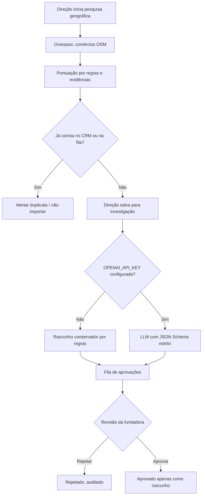

# Workflow: Radar comercial local

O fluxo **não envia e-mails**, não altera o CRM original e não modifica as automações do ChatGPT. Estabelecimentos selecionados ficam em uma fila de pesquisa local, não no cadastro oficial de clientes. Precisam de conferência antes da abordagem.

**Fonte:** dados do OpenStreetMap (© OpenStreetMap contributors, ODbL). O serviço público Overpass não se destina a alta escala comercial.
