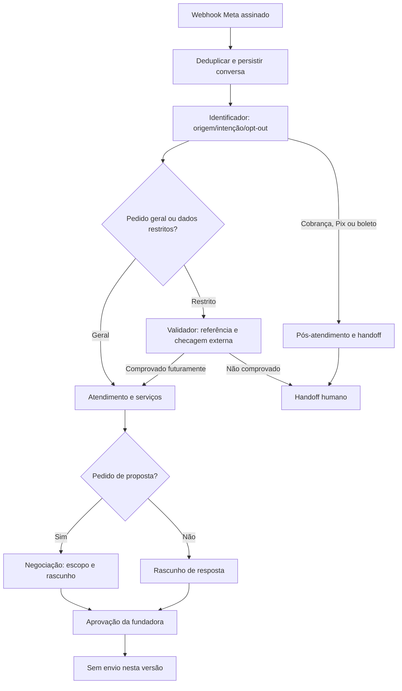

# Orquestração WhatsApp SANSA OS — skeleton v0.5

## Implementação atual
- Webhook validado por **Meta App Secret + HMAC** e challenge de configuração separado.
- Estágios baseados em regras conservadoras, **não em modelo LLM treinado ou agente independente**.
- Rascunhos permanecem somente na central de aprovações; nenhum `/messages` da API Graph implementado.
- Texto de uma mensagem não é comando de sistema. Trate como entrada não confiável.
- Identificação do número **não é validação de identidade**; propostas/contratos exigem prova independente.
- `não insistir` interrompe as futuras propostas internas; recusa deve se propagar às integrações de comunicação antes de qualquer envio.
- Regras de opt-in e templates Meta e janela de 24 horas devem ser observadas ao implementar envio futuro.
- Revisão LGPD: minimização, base legal, retenção, direitos do titular, acesso e registro de incidentes antes de tráfego real.

## Pendências explícitas
1. Meta Business ativado; WABA, Phone Number ID, verify token e app secret configurados.
2. Teste de webhook real com número de teste e autorização de Meta.
3. Verificador de referência autenticado e ferramenta de CRM/VIU de leitura.
4. Envio com política de consentimento e aprovação; recibos e limites.
5. Integração financeira e documentos validados, caso necessário.
